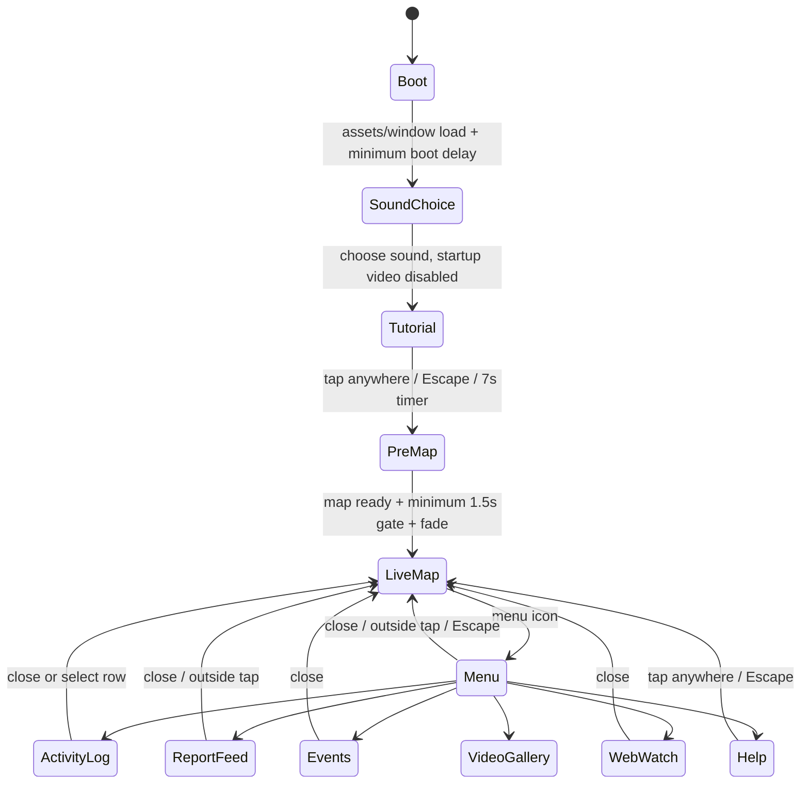

# Screen states and interaction contract

Observed transitions are backed by the PNG/DOM/AX triplets sharing the same filename prefix in `references/` and `evidence/states/`. Source-only alternatives are explicitly marked. The canonical scenario requests are declarative REA actions, not synthetic calls into website application state.

## Startup

This is the observed no-startup-video configuration. Source additionally supports intro video and teaser modes; neither was enabled in the captured site-init object.

Boot draws dim scanlines, an ASCII-style character silhouette, web/character drop progress, and a growing diagnostic-looking text list. These lines are scripted presentation copy, **not real hardware diagnostics**. The source asymptotically approaches90% at80ms intervals until completion. The minimum startup delay is2s after relevant window-load timing; launch stage appears after another1500ms. Sound On and Sound Off are explicit choices. The source initially styles On as selected but master volume begins0; selecting Off is not the same as automatically skipping the choice.

Tutorial opens on first launch unless a consent-permitted seen cookie says otherwise. It reveals background after20ms, intro after220ms, then tooltips starting360ms at120ms increments. Auto-close is7000ms. The nominal Help close button exists in DOM but **CSS display:none**; the real interaction is tap/click anywhere or Escape. The REA first attempt tried that hidden control, timed out, and was corrected to the observed overlay tap. Retained failed evidence is useful to avoid implementing an invented close button.

PreMap waits for both map readiness and1.5s minimum. Label fades400ms, map cover fades520ms, and map scales1.1→1 over700ms with cubic-bezier(.76,0,.24,1). Menu/filter interaction is enabled at premap transition start. Tutorial is a navigable view later, distinct from the temporary startup tutorial mode.

## Persistent controls

| Input/state | Result | Evidence/status |
|---|---|---|
| Menu icon when live | Left menu enters; animated head transforms to close state | `desktop-log-menu-settled`, `phone-log-menu-settled` |
| Same icon / outside / Escape | Menu closes | source and scenario navigation |
| Select menu item | Close other destination panels, open chosen view, close menu | all desktop/phone panel scenarios |
| Confirmed filter | Green↔white; hide/show confirmed markers and log rows; one toast | `*-confirmed-off-settled` |
| Rumored filter | Red↔white; hide/show rumored markers and log rows; one toast | `*-rumored-off-settled` |
| Sound | Toggle sound icon/variant and sound-manager volume | source-confirmed; capture runs chose Off |
| Radar globe | Return to configured global center/zoom, toast | detail scenarios |
| Radar target | Center on cached neighborhood at current zoom, or error toast if no cache | source-confirmed; not exercised with personal precise location |
| Trailer tab | Media/consent path | detail scenarios; see current evidence state |
| Credits | Footer credits panel/arrow opens and closes | `desktop-credits-settled` plus source |

Filters start enabled but are inactive during startup. Both disabled is valid; event/trailer points are not a third filter. Radar category dots use its independent data arrays, so its content need not match marker visibility. The source does not show a search box, new-sighting form, layer selector, zoom+/− pair, standard compass FAB, bottom tabs, or floating GPS dot. Do not add them for visual reconstruction.

## Pin selection and detail

1. Tap a visible marker. Stop map drag/mousedown propagation for marker input and debounce duplicate click/gmp-click events120ms.
2. If markers overlap and zoom is below13.597..., fly to the pin then show its popup. Otherwise show directly.
3. Mark the sighting seen where permitted, updating log and notification bookkeeping.
4. Popup action depends on pin content. Clicking outside or changing camera hides the popup.

| Pin content | CTA / destination |
|---|---|
| Trailer | Play Trailer → YouTube/lightbox route |
| Event | View Event → event side panel, related card focus |
| Confirmed + model ID | View in 3D → model focus (source-only here) |
| Google/custom panorama | View360 → panorama layer (source-only here) |
| Image media | View Sighting → image lightbox |
| URL | External destination |
| Rumored without earlier destination | View Sighting → mechanical message detail |
| No usable content | Visually disabled card |

**Rumored detail is observed** using the public Columbus pin `row13-spotted-by-osuspidey`. It produces a green instrument panel anchored top-right with thumbnail, handle and location, and an amber message button. It does not push a new route or generic bottom sheet.

Opening is staged in300ms phases: wire/base appears, hinge unfolds, content expands, ticker/media fades in. The reverse uses additional phases and finally clears content/returns idle. While animating, input is guarded. Clicking the message button after full close has **no action**, because close cleared the selection. A second capture attempt established this by hitting idle rather than reopening; Android should require another sighting selection, not invent persistent inbox history. Opening another rumored sighting updates the panel via collapse/populate/expand. Map clicks and some other navigation/actions close it.

Tapping the populated thumbnail opens image/video/gallery lightbox. Handle/message links can open external URLs. Data strings must be escaped and validated in the independent implementation even though the site's renderer sometimes constructs HTML templates.

## Activity log

Fills the map interior. Most recent first by creation date; event date handling depends on overrides. Rows carry category icon, badge, title and formatted date; badge hidden at phone widths. Initial section explainer is an overlay within the log, delayed800ms. Close button/backdrop/Escape dismisses the explainer. It is independent of the log close control.

Select a row: persist/mark seen where permitted, close log, fly to pin over2500ms, show popup around2600ms, and open an external URL if the row's pin has one. Filters update both log rows and markers. Reopening resets neither the camera nor arbitrary filters. Log itself supports Escape.

## Report Sightings / X feed

Menu opens a right-hand feed. A pinned introduction appears first; remote posts fetch once per controller lifetime with a loading/busy state. Network failure or empty feed still retains the introduction. Text URLs are linkified. Remote photo galleries have previous/next and dots; videos use controls and pause when hidden or sufficiently out of scroll visibility. Source uses a scroll intersection threshold35% for video pause.

The bottom CTA goes to X's posting destination; **there is no in-site reporting form**. Analysis did not post anything. In an independent app, any external reporting destination is a product dependency to resolve; do not silently post to the original site's account or repurpose its promotion.

## Events

Menu or event popup opens the right-hand panel. First-open info overlay uses the same section-explainer behavior. Underlying list contains event title, location, description, attachments and optional CTA. The captured response is populated, not an empty-state screenshot.

Source supports no-events copy, region-based event data, event focus from marker, image galleries with arrows/dots, inline video poster/play, and optional outgoing URL. These are data-dependent. A source branch does not justify showing an extra button on events without that field. Media playback itself was not used to claim successful trailer/video playback.

## Web Watch

Desktop: first article initially active, previous disabled; next and dots move horizontally with smooth scrolling, bounds-clamped and without infinite wrapping. At the last scroll position, the right fade mask is removed. Close hides panel and tilts/scales its map-line backdrop in a2.5s animation. Open removes that tilt and resets article index0.

Phone/tablet≤768: a vertical scroller, no arrow/dot controls. Width≤550 stacks each200px portrait above its text. This is confirmed in phone screenshots and the failed attempt to click a hidden desktop arrow; final scenario omits that invalid action. Do not implement horizontal swipe pages as a substitute for the observed phone reading list.

## Media, conditional sections, and external actions

Lightbox mode, not a new navigation route, determines whether image, image gallery, YouTube, video gallery, inline video or download choices render. Close/backdrop/Escape paths exist in source; focus/inert gates should be preserved. Consent rejection in these captures blocks the trailer with a cookie-preferences dialog. Fresh consent-accepted Videos captures show the embedded player progressing to about 0:01 and the Now Playing strip. This supports initial muted playback, not complete playback/audio/device certification. The five-item thumbnail list is collapsible; its row animates height/opacity/vertical travel while the Now Playing bar remains. The toggle exposes the list without replacing the video.

Normal Chrome shows six menu items. Samsung-exclusive downloads are conditional on device eligibility, or the publicly shipped `push_test` query switch used solely for a **labeled conditional capture**. `samsung_downloads=true` alone does not bypass device eligibility in the inspected menu logic. The conditional reference is not the normal phone screen.

Observed conditional downloads: map-sized olive/black panel with wallpaper, sticker, emoji sections; horizontal asset rows, vertical scroll, download affordances. Some assets can offer a size chooser. No asset download or notification subscription was performed. Push notifications are disabled in the snapshot boot config; the source subscription implementation is not part of the observed normal UX.

## Animation reconstruction table

| Element | Source motion/timing | Android translation requirement |
|---|---|---|
| Menu panel | translateX−100%→0,240ms ease | Custom panel; preserve direction/envelope |
| Menu links | x−18/scale.98/blur3→normal; delay90+36×index ms | Stagger text, no Material menu animation |
| Activity panel | opacity220, translate22/scale.985 over560, blur8/saturation over420 | Preserve perceptual order; blur is optional only if device unsupported and recorded |
| Help | fade220; background380/550; staged callouts | Independent tutorial-mode timer |
| Web Watch | fade220, y10→0 over280 | Vertical on phone remains vertical |
| X feed | x100%→0,320ms cubic(.16,1,.3,1); opacity220 | Viewport-side overlay |
| Pin card | fade/translate3 over160 | Anchored map popup |
| Count banner | y−60→0 over800; opacity700; delay1000, hold2500 | One transient count banner |
| Message detail |300ms phased mechanical pieces | Cancellable guarded sequence; close clears detail |
| Main ticker | Continuous repeated text; blink mode1500ms | Clip, loop without seam; measured speed should use elapsed time |
| Radar | angle+0.018/frame | Time-based equivalent≈1.08rad/s at60Hz |
| Event glow |1.8s loop, scale1→1.06 | Only highlighted event pins |
| Trailer pulse |2.1s, two rings offset1s | Keep separate from event highlight |
| Menu head | loop12fps, close segment18fps | Original replacement frames at corresponding cadence |
| Lower character |12fps sprite loop | Original character, same footprint/cadence |
| Toast |300ms enter,1000 hold,350 exit | Replace active toast rather than stack |

Animation timings are source measurements, not frame-by-frame Android validation. Reduced-motion alternatives and lifecycle pause are Android accessibility/engineering adaptations and should not create additional visual controls.
