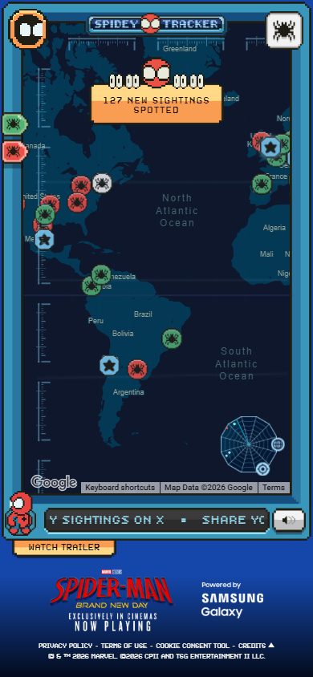
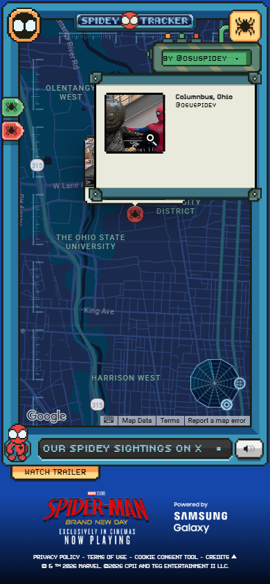

# Reference screenshots

Canonical REA captures: 223. Each PNG is hash-verified against its raw Evidence. All sizes below are viewport pixels at DPR1. The conditional downloads capture uses the public push_test switch and is not the normal Chrome UI.

| Scenario/state | Size | PNG |
|---|---|---|
| desktop / sound-choice | 1440×1000 | [Open](desktop-sound-choice.png) |
| desktop / tutorial-settled | 1440×1000 | [Open](desktop-tutorial-settled.png) |
| desktop / map-ready | 1440×1000 | [Open](desktop-map-ready.png) |
| desktop / log-menu-settled | 1440×1000 | [Open](desktop-log-menu-settled.png) |
| desktop / confirmed-off-settled | 1440×1000 | [Open](desktop-confirmed-off-settled.png) |
| desktop / rumored-off-settled | 1440×1000 | [Open](desktop-rumored-off-settled.png) |
| desktop / log-settled | 1440×1000 | [Open](desktop-log-settled.png) |
| desktop / log-content | 1440×1000 | [Open](desktop-log-content.png) |
| desktop / report-loaded | 1440×1000 | [Open](desktop-report-loaded.png) |
| desktop / events-settled | 1440×1000 | [Open](desktop-events-settled.png) |
| desktop / events-content | 1440×1000 | [Open](desktop-events-content.png) |
| desktop / webwatch-settled | 1440×1000 | [Open](desktop-webwatch-settled.png) |
| desktop / webwatch-content | 1440×1000 | [Open](desktop-webwatch-content.png) |
| desktop / webwatch-next-settled | 1440×1000 | [Open](desktop-webwatch-next-settled.png) |
| desktop / help-content | 1440×1000 | [Open](desktop-help-content.png) |
| desktop / pin-settled | 1440×1000 | [Open](desktop-pin-settled.png) |
| desktop / credits-settled | 1440×1000 | [Open](desktop-credits-settled.png) |
| phone / map-ready | 390×844 | [Open](phone-map-ready.png) |
| phone / log-menu-settled | 390×844 | [Open](phone-log-menu-settled.png) |
| phone / log-content | 390×844 | [Open](phone-log-content.png) |
| phone / report-loaded | 390×844 | [Open](phone-report-loaded.png) |
| phone / events-content | 390×844 | [Open](phone-events-content.png) |
| phone / webwatch-content | 390×844 | [Open](phone-webwatch-content.png) |
| phone / help-content | 390×844 | [Open](phone-help-content.png) |
| tablet / help-content | 768×1024 | [Open](tablet-help-content.png) |
| landscape / map-ready | 844×390 | [Open](landscape-map-ready.png) |
| detail-desktop / rumor-card | 1440×1000 | [Open](detail-desktop-rumor-card.png) |
| detail-desktop / message-open | 1440×1000 | [Open](detail-desktop-message-open.png) |
| detail-phone / message-open | 390×844 | [Open](detail-phone-message-open.png) |
| detail-phone / sighting-media-open | 390×844 | [Open](detail-phone-sighting-media-open.png) |
| detail-phone / message-collapsed | 390×844 | [Open](detail-phone-message-collapsed.png) |
| detail-desktop / global-settled | 1440×1000 | [Open](detail-desktop-global-settled.png) |
| detail-desktop / trailer-result | 1440×1000 | [Open](detail-desktop-trailer-result.png) |
| detail-phone / trailer-result | 390×844 | [Open](detail-phone-trailer-result.png) |
| downloads-conditional / downloads-settled | 1440×1000 | [Open](downloads-conditional-downloads-settled.png) |
| videos-desktop / gallery-result | 1440×1000 | [Open](videos-desktop-gallery-result.png) |
| videos-phone / gallery-result | 390×844 | [Open](videos-phone-gallery-result.png) |

See [reference-manifest.json](../evidence/reference-manifest.json) for every capture, SHA-256 and canonical Evidence ID. Screenshots left by earlier attempts are excluded from that canonical manifest.

## Phone map

## Phone sighting detail

- [videos-desktop: expanded video list](videos-desktop-gallery-list-visible.png)
- [videos-phone: expanded video list](videos-phone-gallery-list-visible.png)